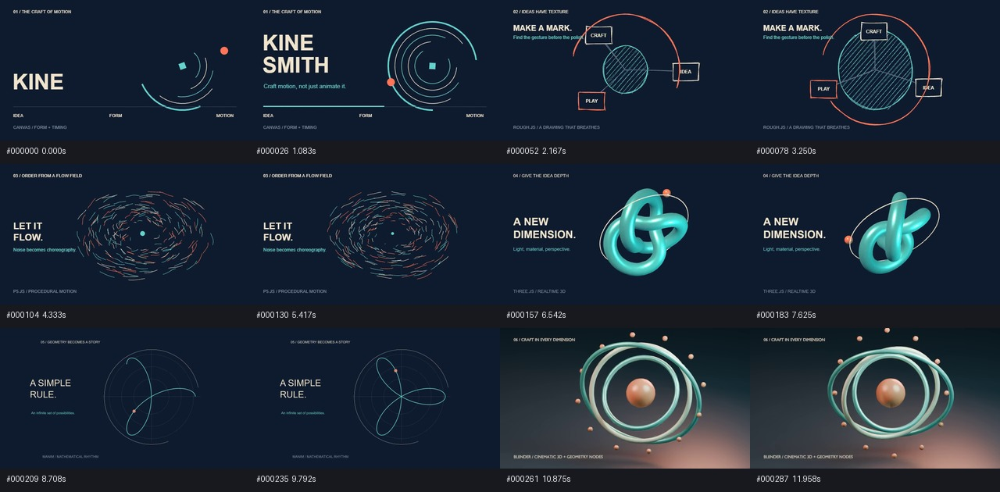
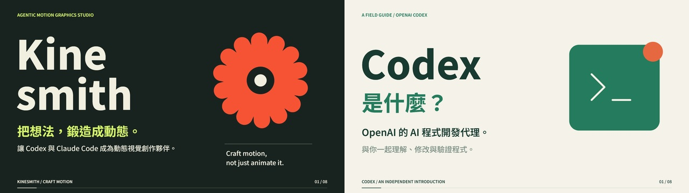

# Kinesmith

**Craft motion, not just animate it.**

[GitHub Releases](https://github.com/bigtongue5566/kinesmith/releases) 提供可安裝 Plugin、雙平台 marketplace 與可編輯作品包。原始碼採 MIT 授權。



[觀看六引擎展示影片](https://github.com/bigtongue5566/kinesmith/releases/download/v0.1.0/orbital-craft.mp4) · [驗收紀錄與已知限制](docs/acceptance.md)

新增兩部完整介紹作品：**Kinesmith：把想法鍛造成動態**，以及 **Codex 是什麼？** 每部 48 秒、1080p／30fps、繁體中文動態字排，搭配不同的原創配樂。包括 8 章分鏡、可編輯原生來源、字型、MIDI、Cue Sheet 與字幕，見 [介紹作品與重現方法](examples/introductions/README.md)。Codex 片為依 OpenAI 官方文件查核的獨立介紹。



| 作品 | 完整影片 | 可編輯來源 |
|---|---|---|
| Kinesmith 專案介紹 | [觀看／下載 MP4](https://github.com/bigtongue5566/kinesmith/releases/download/examples-introductions-v1/kinesmith-introduction.mp4) | [分鏡與設計](examples/introductions/brief-kinesmith.md) |
| Codex 是什麼？ | [觀看／下載 MP4](https://github.com/bigtongue5566/kinesmith/releases/download/examples-introductions-v1/codex-explained.mp4) | [分鏡與來源](examples/introductions/brief-codex.md) |

[下載兩部介紹作品包](https://github.com/bigtongue5566/kinesmith/releases/tag/examples-introductions-v1) · [實測與視覺修訂報告](docs/introduction-films.md)。也可直接從本 repository 的 `examples/introductions/` 編輯／重現。此範例集獨立發行，不更改 Plugin v0.1.0 的版本號。

Kinesmith 讓目前的 Codex／Claude Code Agent 自主做視覺概念、分鏡、2D／3D 動畫、Typography、程序化圖形、特效、渲染與修訂。共用 Skills、專業知識與作品格式，使用各平台原生 Plugin／可選 Subagents，不呼叫第二個生成模型。

六個引擎保留原生能力：Canvas API、Rough.js、p5.js、Three.js、Manim Community、Blender。工程 Helpers 提供固定影格時間、跨引擎合成、FFmpeg 輸出、音訊分析、版本與查核；沒有統一動畫物件 API、常駐 Agent runtime、額外 MCP 或資料庫。

```powershell
git clone https://github.com/bigtongue5566/kinesmith.git
cd kinesmith
uv sync --python 3.11 --all-extras --locked
uv run --all-extras playwright install chromium
uv run --all-extras scripts/bootstrap_web.py
uv run --all-extras kinesmith doctor
uv run --all-extras kinesmith --help
uv run --all-extras pytest
uv run --all-extras scripts/build_release.py
```

也可從 [v0.1.0 Release](https://github.com/bigtongue5566/kinesmith/releases/tag/v0.1.0) 下載：`kinesmith-0.1.0.zip` 為通用 Plugin，`kinesmith-marketplace-0.1.0.zip` 為雙平台本地安裝來源，`kinesmith-works-0.1.0.zip` 含完整影片、可編輯 Blender／音樂作品與檢查報告。解壓 marketplace 後依 [安裝文件](docs/installation.md) 註冊；原始碼版的 `vendor/` 由 bootstrap 取得，Release 已隨附固定版本及其來源授權。

使用方法見 [安裝](docs/installation.md)、[專業知識](docs/knowledge-base.md)、[渲染與作品格式](docs/rendering.md)、[Opusmith Adapter](docs/opusmith.md)、[授權](docs/licenses.md)、[實際驗收與限制](docs/acceptance.md)。`examples/` 保存可編輯原生來源，`outputs/` 保存實際渲染、Contact Sheet 與驗證報告。可用 `uv run --all-extras kinesmith init <目錄>` 建立作品；`validate`、`render`、`qa`、`revise` 的參數以 `--help` 為準。

Opusmith 保持獨立：一般音訊可直接做 Audio-Reactive MoGraph；安裝 Opusmith 時透過版本與能力偵測的 Adapter，以及可攜 AV Contract 協作 Music-First、Visual-First、Joint Creation。外部音樂專案唯讀，音符、歌詞、人聲時間精度與效果尾音分開記錄，不假設通用 Plugin-to-Plugin API。

每件作品保留 Prompt／修訂歷史、Motion Brief、原生來源、素材授權、工具版本、來源校驗、音樂與動畫版本關聯、影片預覽與 Motion Report。文件預設繁體中文。核心使用免費開源工具與 Web 標準；第三方軟體、字型、聲庫、素材與編碼器的實際授權義務仍需依作品記錄。

`uv run --all-extras scripts/validate_plugins.py --native --render-smoke` 驗證雙平台原生 CLI 安裝、discovery 與安裝後渲染，結果在 `outputs/platform-validation.json`。模型創作、人工視覺／聽覺評審等未實際執行的項目不宣稱通過。

Kinesmith 原始碼使用 MIT 授權；第三方授權不受此授權取代。
